# OneApp

> **把散落电脑各处的免安装绿色软件、自研小工具和开发项目，统统装进一个随时可以拷贝带走的便携软件盒，按一下快捷键就能秒开！**

<p align="center">
  
</p>

<p align="center">
  <a href="https://backbay2-yzg.github.io/OneApp/"><strong>📖 在线图文使用手册（GitHub Pages）</strong></a>
  &nbsp;·&nbsp;
  <a href="#3-步快速上手小白零门槛">🚀 3 步快速上手</a>
  &nbsp;·&nbsp;
  <a href="#详细功能使用手册">📚 详细功能手册</a>
  &nbsp;·&nbsp;
  <a href="#开发者从源码编译与运行">🛠️ 从源码编译</a>
</p>

<p align="center">
  
  
  
  
  
  <a href="https://backbay2-yzg.github.io/OneApp/"></a>
</p>

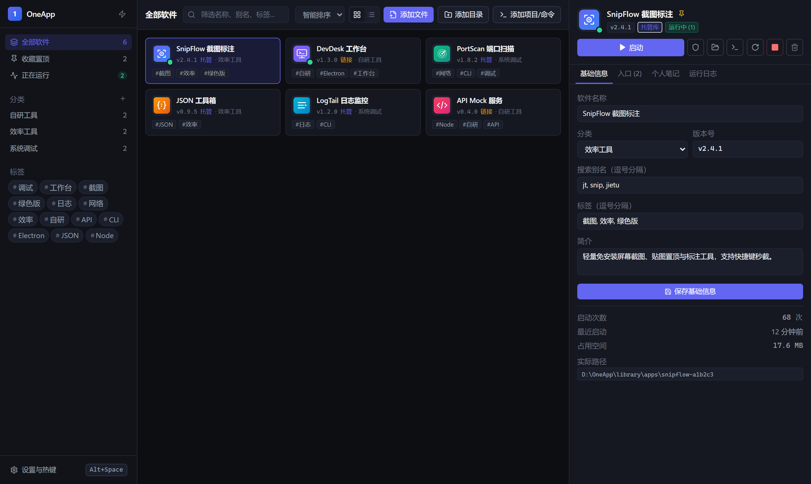

---

## 目录

- [1. 为什么需要 OneApp？](#1-为什么需要-oneapp)
- [2. 核心功能一览](#2-核心功能一览)
- [3. 3 步快速上手（小白零门槛）](#3-3-步快速上手小白零门槛)
- [4. 详细功能使用手册](#4-详细功能使用手册)
  - [4.1 管理主窗口：收纳、整理与一键启动](#41-管理主窗口收纳整理与一键启动)
  - [4.2 极速启动条（Alt + Space）：敲拼音 1 秒找到并启动](#42-极速启动条alt--space敲拼音-1-秒找到并启动)
  - [4.3 托盘快捷浮窗与托盘菜单：鼠标党最顺手的小弹窗](#43-托盘快捷浮窗与托盘菜单鼠标党最顺手的小弹窗)
  - [4.4 源码项目与自定义命令：开发中的项目也能一键构建启动](#44-源码项目与自定义命令开发中的项目也能一键构建启动)
  - [4.5 详情抽屉深度配置：图标、多入口、笔记与实时日志](#45-详情抽屉深度配置图标多入口笔记与实时日志)
  - [4.6 设置与全局热键：按你的习惯定制 OneApp](#46-设置与全局热键按你的习惯定制-oneapp)
- [5. 绿色便携目录结构与换电脑搬家指南](#5-绿色便携目录结构与换电脑搬家指南)
- [6. 常见问题 FAQ（小白排障）](#6-常见问题-faq小白排障)
- [7. 开发者：从源码编译与运行](#7-开发者从源码编译与运行)
- [8. 设计文档与后续规划](#8-设计文档与后续规划)

---

## 1. 为什么需要 OneApp？

电脑用久了，桌面、下载文件夹、D 盘、E 盘里总是堆满各种免安装绿色软件和自己写的小工具：

- **到处找文件太麻烦**：每次想用某个 `.exe` 或 `.bat` 脚本，都要翻好几层文件夹；解压出来的压缩包一多，桌面乱成一团。
- **想不起来叫什么、参数怎么传**：自己写的命令行工具或冷门小软件，几个月不用就忘掉英文名，也不记得要加 `--port` 还是 `--config`。
- **源码项目启动步骤繁琐**：写到一半的 Electron / Node / Python / Go 项目，每次都要开终端、`cd` 进目录、检查构建产物有没有生成再启动。
- **换台电脑全部重来**：绿色软件分散在不同盘符，换电脑或重装系统时很难一次性打包带走。

**OneApp 就是为了解决这 4 件事而生的：**
1. **一个盒子收好所有绿色工具**：支持直接拖入 `.exe`、整个软件文件夹、`.zip`/`.7z` 压缩包、脚本和快捷方式，自动剥离多余套壳目录并提取图标与版本信息。
2. **多种顺手方式秒开**：主窗口分类浏览、`Alt + Space` 极速启动条搜中文/拼音首字母/别名、系统托盘浮窗鼠标一键点击。
3. **开发项目免打包直启**：识别 Electron / Node 项目并生成多入口，支持“产物缺失时自动构建”或“每次启动前构建”，并实时捕获运行日志。
4. **纯正绿色便携**：所有数据与托管程序均以相对路径存放在同目录 `data/` 与 `library/` 下，整个 `OneApp` 文件夹拷进 U 盘或网盘，插上任何 Windows 电脑直接打开就能用。

---

## 2. 核心功能一览

| 模块 | 已实现核心能力 | 小白能直接用来干什么 |
| :--- | :--- | :--- |
| **三形态桌面交互** | **管理主窗口** + **极速启动条**（`Alt+Space`） + **托盘快捷浮窗** & 原生右键菜单 | 平时安静蹲在右下角托盘不占桌面；用键盘按 `Alt+Space` 秒搜，用鼠标点一下托盘图标即开即走 |
| **多格式智能入库** | 支持 `.exe`、绿色文件夹、`.zip` / `.7z` 压缩包、`.bat` / `.cmd` / `.ps1` 脚本、`.lnk` 快捷方式、源码项目目录 | 把下载好的绿色压缩包或工具文件夹直接往窗口里一拖，自动解压、自动挑出主程序、自动提取图标 |
| **三种存储方式** | **复制入托管库**、**移动入托管库**、**仅链接原路径**（支持记住默认方式 / 静默入库） | 绿色软件安心放进 OneApp 托管盒；正在开发的源码项目或超大软件用“仅链接原路径”留在原地 |
| **毫秒级多维搜索** | 中文全拼、拼音首字母、自定义别名、模糊匹配、`#标签`、`@分类`、`:running`、`:pinned` + Frecency 智能排序 | 记不清软件全名？打 `jt` 就能找到“截图标注”，打 `:running` 只看正在运行的工具，越常用的越排前面 |
| **多入口与项目构建** | 单软件可配多个入口（`exe`/`command`/`bat`/`cmd`/`ps1`/`lnk`）、`{{APP_DIR}}` 参数模板、环境变量、隐藏黑窗、按需 UAC 提权、前置构建 | 一个软件可同时保存“正常启动”和“带参数/开发模式”；构建和运行日志直接看，不用开黑框 |
| **Markdown 笔记与日志** | 内置 Markdown 个人笔记编辑/预览（同步显示在启动条右侧）、实时捕获隐藏控制台输出（最多保留 500 行，支持复制/清空） | 把工具的快捷键、命令参数和踩坑记录直接写在软件旁边，下次在启动条里一眼看到 |
| **纯绿色便携架构** | 单文件 `OneApp.exe`（内嵌前端资源）+ 纯 Go SQLite（WAL 模式）+ 相对路径托管库 | 不写乱七八糟的系统垃圾，换电脑只需复制整个文件夹（可选开启 Windows 开机自启） |

---

## 3. 3 步快速上手（小白零门槛）

### 第 1 步：打开 OneApp

1. 双击运行 **`OneApp.exe`**（如果是从源码编译，产物默认位于 `build/bin/OneApp.exe`）。
2. 首次启动时，OneApp 会在自己所在的同一目录下自动创建：
   - `data/`（存放本地数据库 `oneapp.db`、设置 `settings.json`、缓存图标 `icons/` 等）
   - `library/`（存放你托管进来的绿色软件）
   - 3 个默认分类：**自研工具**、**效率工具**、**系统调试**（你也可以随时新建或删除分类）。
3. 点击右上角 `×` 关闭主窗口时，默认会**最小化到 Windows 右下角系统托盘**继续后台待命，方便随时用快捷键唤醒。

---

### 第 2 步：把你的第一个软件放进来

把你的绿色软件加进 OneApp 有 **3 种最简单的方法**：

- **方法 A（最推荐）**：直接把电脑上的 `.exe` 文件、绿色软件整个文件夹、`.zip` / `.7z` 压缩包、`.bat`/`.ps1` 脚本、桌面快捷方式 `.lnk` 或源码项目文件夹，**用鼠标拖进 OneApp 主窗口（或拖到托盘快捷浮窗上）**松手！
- **方法 B**：点击主窗口右上角的 **`添加文件`** 或 **`添加目录`** 按钮浏览选择。
- **方法 C**：如果是开发中的代码项目（如 Python、Go、Electron、Node），点击 **`添加项目/命令`** 按钮。

拖入后会自动弹出**「确认入库软件 / 项目」**窗口，帮你自动识别名称、版本、主程序和子入口：

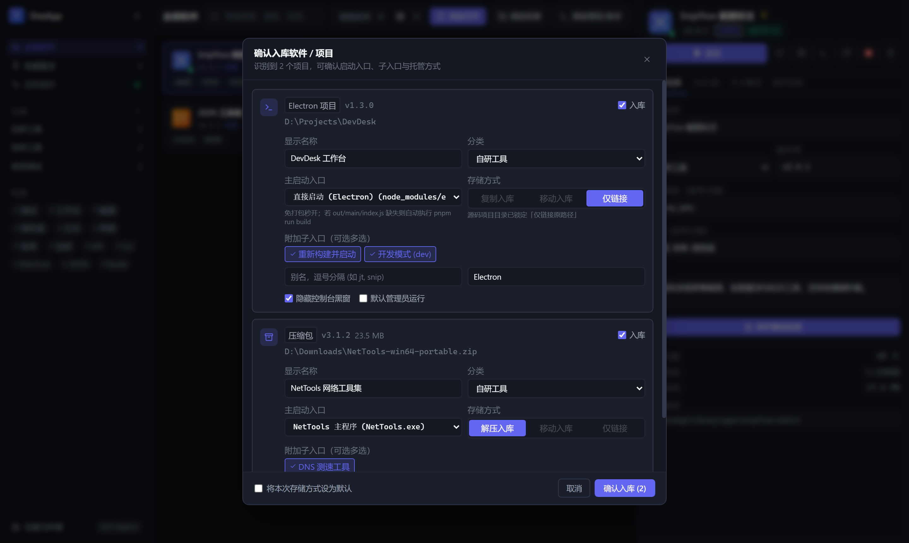

> **💡 小白必看：三种存储方式怎么选？**
>
> | 存储方式 | 会发生什么 | 适合什么情况 |
> | :--- | :--- | :--- |
> | **复制入托管库 / 解压入库**（默认推荐） | 把软件完整复制（或把压缩包自动解压）到 `OneApp/library/apps/` 里，原文件留在原处不动 | 最安全！适合所有单文件 `.exe`、绿色文件夹、`.zip` / `.7z` 压缩包 |
> | **移动入托管库** | 把原软件文件夹直接搬进 `OneApp/library/apps/`，原路径不再保留，桌面/下载目录瞬间清爽 | 确定以后都由 OneApp 统一管理，不想在硬盘上留两份重复文件 |
> | **仅链接原路径** | 文件完全不移动、不复制，OneApp 只记住它在电脑上的原位置 | 适合**正在频繁改代码的开发项目**、或体积特别大的软件（源码项目会自动锁定此模式） |

选好分类、别名或标签后，点击右下角蓝色 **`确认入库`** 按钮即可完成！

> **✨ 贴心小细节**：如果你拖入的 `.zip`/`.7z` 压缩包里面多套了一层文件夹（比如 `tool-v1.0/tool-v1.0/tool.exe`），OneApp 会**自动剥离外层空套壳**，让目录干净整洁，并自动过滤 `uninstall.exe`、`vcredist` 等安装卸载辅助程序，帮你挑出真正的主程序。

---

### 第 3 步：用你最顺手的方式秒开软件

入库成功后，以后你想打开这个软件，共有 **3 种方式**任选：

1. **在主窗口打开**：在中间卡片或列表上**双击软件**，或点卡片右上角播放按钮，或选中后点右侧蓝色 **`启动`** 按钮。
2. **用键盘全局快捷键秒开（最推荐）**：无论你正在浏览网页、写代码还是看文档，随时按下 **`Alt + Space`** 呼出居中的**极速启动条**，敲几个字母或拼音首字母，按 **`Enter`** 回车立刻启动！
3. **用鼠标点右下角托盘图标**：单击屏幕右下角系统托盘里的 OneApp 图标，弹出小巧精致的**托盘快捷浮窗**，点一下软件就能直接运行。

---

## 4. 详细功能使用手册

### 4.1 管理主窗口：收纳、整理与一键启动


主窗口采用清晰直观的三栏式布局，从左到右分别是：

1. **左侧导航栏（智能视图 + 分类 + 标签）**
   - **智能视图**：
     - **全部软件**：显示库内所有软件总数。
     - **收藏置顶**：只看你点了图钉收藏的常用软件。
     - **正在运行**：实时用绿色数字徽章标出当前有几个由 OneApp 启动的程序正在跑，点进去可一眼查看并管理进程。
   - **分类管理**：点击「分类」右侧的 **`+`** 号可以新建自定义分类（输入名称后回车保存）；鼠标悬停在自己建的分类上可点击垃圾桶图标删除分类。
   - **标签云**：点击任意 `#标签` 可按标签筛选；再点一次取消筛选。
   - **左下角设置与热键**：实时显示当前全局热键（例如 `Alt+Space`）；如果跟电脑上其他软件冲突，这里会弹出醒目的黄色警告条，点击直接改键。
   - **左上角闪电图标 ⚡**：点击可直接呼出极速启动条。

2. **中间工作区（搜索筛选 + 视图切换 + 拖拽热区）**
   - **顶部筛选框**：输入软件名、搜索别名或标签关键词，列表实时过滤。
   - **4 种排序方式**：
     - `智能排序`：优先显示收藏置顶和正在运行的软件，再按最近启动时间和启动次数排；
     - `名称排序`：按中文拼音 / 字母顺序；
     - `启动次数`：按最常使用的次数从高到低；
     - `最近添加`：按入库先后排序，刚加的工具排在最前面。
   - **双视图切换**：右上角按钮可一键切换 **紧凑卡片网格** 与 **高密度列表**（列表视图可同时显示主程序路径和累计启动次数）。
   - **全区拖放入库**：把文件或文件夹直接拖到中间区域上方时，会出现虚线高亮提示框，松手即解析入库。

3. **右侧详情抽屉**：选中任意软件即可查看和编辑它的全部信息、多入口、个人笔记与运行日志（详见 [4.5 节](#45-详情抽屉深度配置图标多入口笔记与实时日志)）。

---

### 4.2 极速启动条（`Alt + Space`）：敲拼音 1 秒找到并启动

按下默认全局热键 **`Alt + Space`**（可在设置中修改），会在屏幕正中央弹出无边框极速启动条。即使什么都不输，也会自动按“收藏置顶 + 正在运行 + 最近使用”智能排序推荐给你（新入库 48 小时内的工具还会获得冷启动加权，不用担心刚加进去搜不到）。

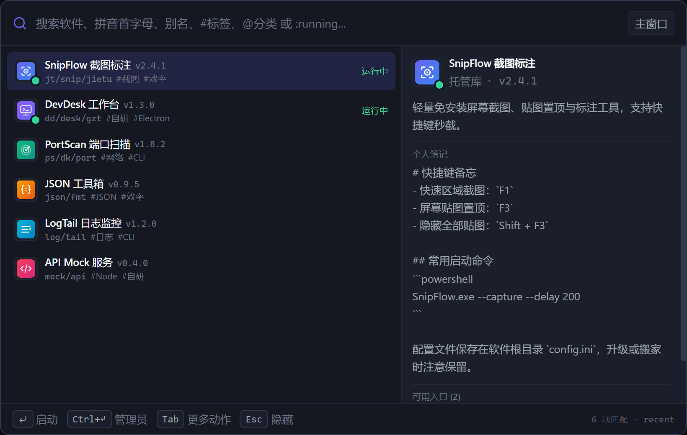

#### 🔍 搜索语法速查表（支持中英文混输与快捷过滤）

| 你输入的内容 | 实际搜索效果 | 举例 |
| :--- | :--- | :--- |
| **软件名 / 英文子串** | 匹配完整名称、前缀、子串，甚至隔字模糊序列 | 输 `snip` 命中 `SnipFlow 截图标注` |
| **中文全拼** | 自动将中文软件名转为全拼匹配 | 输 `jietu` 命中 `SnipFlow 截图标注` |
| **拼音首字母** | 直接敲每个汉字的首字母 | 输 `jt` 命中 `截图`，输 `dk` 命中 `端口扫描` |
| **自定义别名** | 优先精确匹配你设置的短别名（权重最高） | 设了别名 `dd`，敲 `dd` 永远排第一 |
| **`#标签名`** | 只看带有指定标签的软件（可叠加关键词） | `#截图` 或 `#CLI 端口` |
| **`@分类名`** | 只看某个分类下的软件 | `@自研` 或 `@效率工具` |
| **`:running`** | 只显示当前正在运行中的软件（方便快速切过去关掉或重启） | `:running` |
| **`:pinned`** | 只显示收藏置顶的软件 | `:pinned` |

#### ⚡ `Tab` 二级动作面板与快捷键

在启动条里选中某个软件后，不用切回主窗口，按一下 **`Tab`** 键，右侧面板立即切换为针对该软件的**动作菜单**：

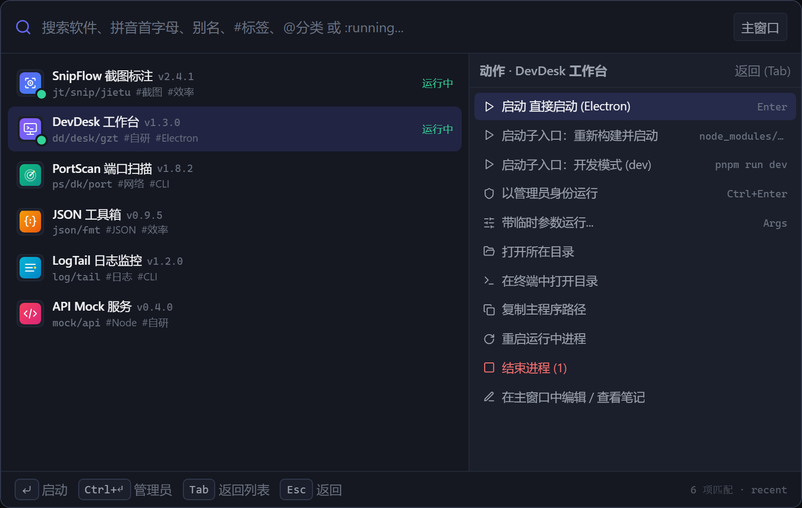

支持的动作包括：
- **启动默认入口** / **启动配置好的各个子入口**（如“开发模式 (dev)”、“静默截屏模式”）
- **以管理员身份运行**（触发 Windows UAC 提权）
- **带临时参数运行...**（弹出单行输入框，临时追加本次命令行参数如 `--port 9000`，不会改掉永久配置）
- **打开所在目录**（在文件资源管理器中打开并高亮定位主程序）
- **在终端中打开目录**（在软件工作目录直接打开 PowerShell / Windows Terminal）
- **复制主程序路径 / 复制启动命令**
- **取消当前构建**（当软件正在执行前置构建时出现）
- **重启运行中进程 / 结束进程**（仅在软件处于运行中时出现）
- **在主窗口中编辑 / 查看笔记**（一键跳回主窗口并精准选中该软件）

**极速启动条键盘快捷键：**

| 快捷键 | 作用 |
| :--- | :--- |
| `Alt + Space` | 全局随时呼出 / 隐藏启动条（可在设置修改） |
| `↑` / `↓` | 上下选择软件或二级动作 |
| `Enter` | 立即启动当前选中的软件 / 执行当前动作并隐藏窗口 |
| `Ctrl + Enter` | 强制以**管理员身份**运行当前软件 |
| `Tab` | 在「软件信息/笔记预览」与「二级动作菜单」之间来回切换 |
| `Esc` | 逐级退回：关闭临时参数 → 返回搜索列表 → 清空搜索词 → 隐藏启动条 |

---

### 4.3 托盘快捷浮窗与托盘菜单：鼠标党最顺手的小弹窗

如果你更喜欢鼠标点一点，**左键单击 Windows 右下角任务栏托盘区的 OneApp 图标**，就会贴着任务栏弹出小巧的**托盘快捷浮窗**（位置自动贴边对齐）。

<p align="center">
  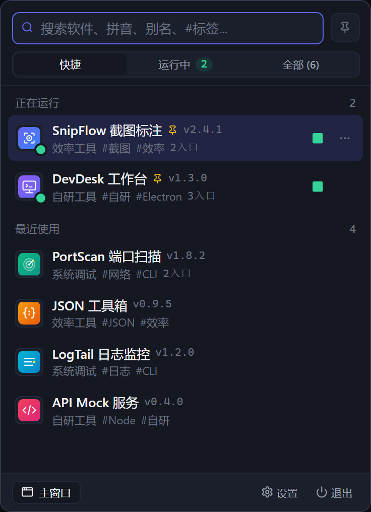
  &nbsp;&nbsp;&nbsp;&nbsp;
  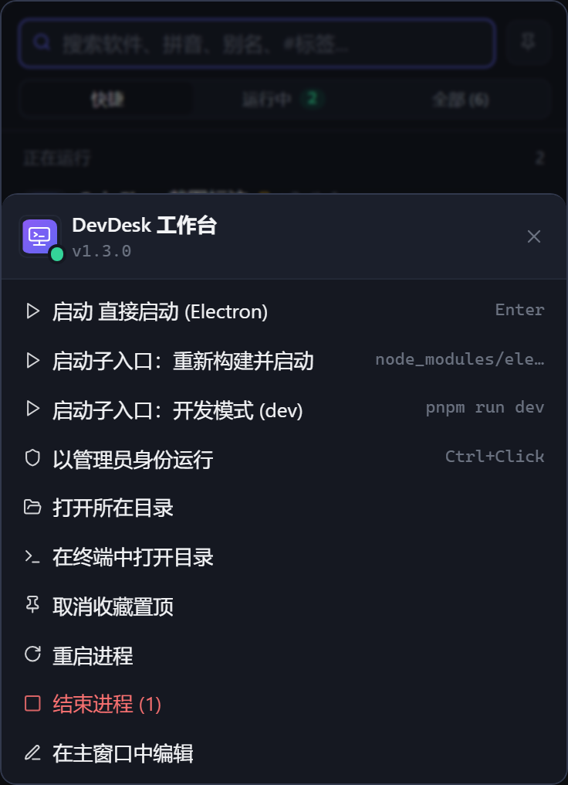
</p>

**托盘浮窗怎么用？**
- **三合一标签页**：
  - **快捷**：自动按 `正在运行` → `收藏置顶` → `最近使用` 分组展示最常用的软件。
  - **运行中**：集中显示所有正在运行的软件，点行右侧的绿色方块图标 ■ 可**直接结束进程**。
  - **全部**：显示全部软件，并在顶部多出一排分类筛选胶囊（`全部分类` / `自研工具` / `效率工具` 等）。
- **右上角图钉按钮 📌**：平时点击一个软件启动后浮窗会自动收起；如果需要连续打开 3、4 个工具，点亮右上角**图钉**把浮窗固定在屏幕上，再点就不会自动隐藏！
- **悬停/右键「更多操作」**（见右图）：右键点击任意一行，或点击行右侧 `...` 按钮，弹出底部操作面板，可选择启动任意子入口、管理员运行（或按住 `Ctrl + 左键点击` 直接管理员启动）、打开目录/终端、置顶/取消置顶、重启/结束进程或跳转到主窗口编辑。
- **直接拖文件到浮窗上也能入库！** 托盘浮窗同样支持系统文件拖放，不用先打开主窗口。
- **托盘图标右键原生菜单**：右键右下角托盘图标，可一键「显示管理主窗口」「打开托盘快捷浮窗」「打开极速启动条」「最近使用（前 5 个软件直启）」或「退出 OneApp」。

---

### 4.4 源码项目与自定义命令：开发中的项目也能一键构建启动

如果你是一个开发者，平时写了 React、Electron、Node、Python、Go、Rust 等项目，OneApp 可以用**「仅链接原路径」**的方式把它们纳管进来，既不会拷贝庞大的 `node_modules`，又能像普通软件一样被快捷启动。

点击主窗口右上角的 **`添加项目/命令`** 按钮，或者直接把源码项目文件夹拖入窗口：

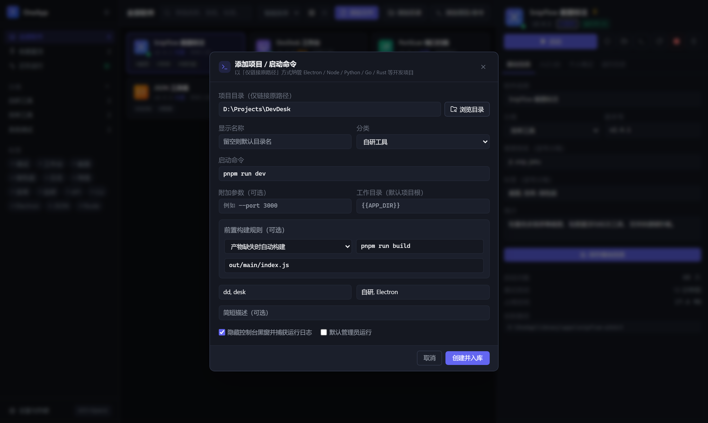

1. **自动识别 Electron / Node 项目**：
   - 当拖入或选择了带 `package.json` 的目录时，OneApp 会自动检测包管理器（根据 `packageManager` 字段与锁文件自动识别 **`pnpm` / `yarn` / `bun` / `npm`**），自动从项目配置或 `build/`、`assets/`、`resources/` 中提取图标。
   - 如果是 **Electron 项目**，还会贴心地为你一次生成 3 个实用入口：
     1. **`直接启动 (Electron)`**：免打包直接调用本地 `electron.exe .`，并配置「若 `out/main/index.js` 等构建产物缺失则自动先执行 `pnpm run build`」；
     2. **`重新构建并启动`**：每次启动都先重新运行构建命令，构建成功后再自动重启新版进程；
     3. **`开发模式 (dev)`**：自动匹配 `pnpm run dev`（或 `npm run dev`）热更新命令。
   - 在「添加项目/命令」弹窗中填写路径失去焦点后，如果识别到 Electron/Node 项目，也会出现高亮提示条，点**「一键解析导入」**就能直接使用自动生成的入口组合。
2. **任意自定义命令（Python / Go / Rust / 脚本服务）**：
   - 选好项目目录，在**「启动命令」**里填写例如 `python main.py`、`go run .` 或 `cargo run`，工作目录默认使用 `{{APP_DIR}}`（即项目根目录）。
   - **前置构建规则（可选）**：
     - `不启用前置构建`：直接运行启动命令；
     - `产物缺失时自动构建`：指定一个产物检测路径（例如 `out/main/index.js` 或 `dist/app.exe`），只有文件不存在时才先运行构建命令；
     - `每次启动前构建`：每次点击启动都先构建再启动，并在必要时关闭旧运行实例。
   - 勾选**「隐藏控制台黑窗并捕获运行日志」**后，运行时的所有标准输出和报错都会实时收集到右侧「运行日志」面板里，桌面不再弹出黑乎乎的命令行窗口！

---

### 4.5 详情抽屉深度配置：图标、多入口、笔记与实时日志

选中左侧列表中的任意软件，右侧详情抽屉提供了从头到尾的精细化管理能力：

#### 1. 顶部操作栏与基础信息
- **图标自定义**：鼠标悬停在右上角软件图标上，会出现两个小按钮——**自定义图标**（支持选 `.png` / `.ico` / `.exe`）和**重新提取图标**。
- **常用操作栏**：支持**启动**、**管理员运行（盾牌图标）**、**打开所在目录（文件夹图标）**、**在终端中打开（`>_` 图标）**、**重启 / 停止进程**、**收藏置顶（图钉）**以及**移除软件**（若为托管库软件，删除时会让你勾选是否同时删除磁盘上的程序文件，防止误删）。
- **基础信息**：修改软件显示名称、分类、版本号、逗号分隔的搜索别名和标签、简介，下方还会显示累计启动次数、最近启动时间、托管目录占用空间和实际磁盘路径。

#### 2. 多入口与运行参数配置

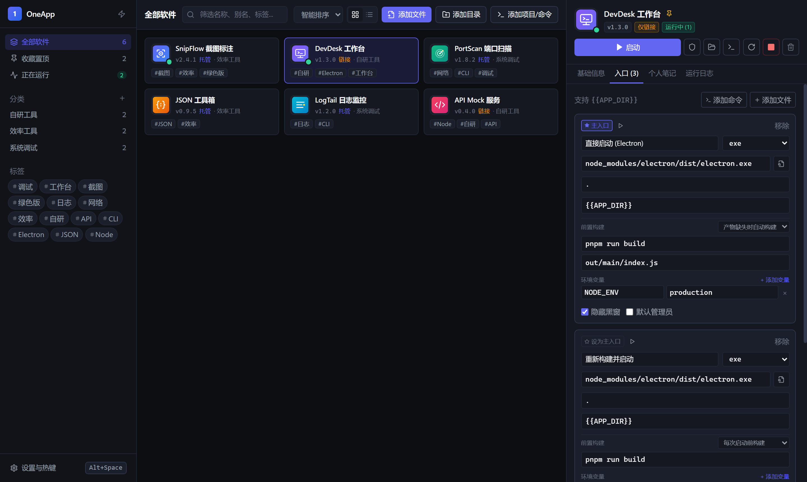

切换到 **「入口」** 标签页，你可以为一个软件配置无限多个启动方式（例如同时保留图形界面、带参数的 CLI 模式、后台服务模式）：
- **点击 `设为主入口`**：决定按 `Enter` 或双击卡片时默认跑哪一个入口；点旁边小三角 `▶` 可单独测试启动某一条入口。
- **6 种入口类型**：`exe`、`command`（命令）、`bat`、`cmd`、`ps1`、`lnk`。
- **路径占位变量**：在「启动参数」「工作目录」或「前置构建命令」里支持 3 个内置变量：
  - `{{APP_DIR}}`：该软件的根目录（如果是托管软件，哪怕你把 OneApp 拷到另一台电脑的 `E:\Tools`，它也会自动解析成新盘符下的路径！）
  - `{{ENTRY_DIR}}`：当前入口文件所在的文件夹
  - `{{ONEAPP_DIR}}`：OneApp 本体所在的便携根目录
- **环境变量注入**：点 `+ 添加变量` 可为单个入口注入专用环境变量（如 `NODE_ENV=production`、`PORT=4010`）。
- **运行开关**：每个入口均可独立勾选 **隐藏黑窗** 与 **默认管理员**。

#### 3. 个人使用笔记（Markdown）

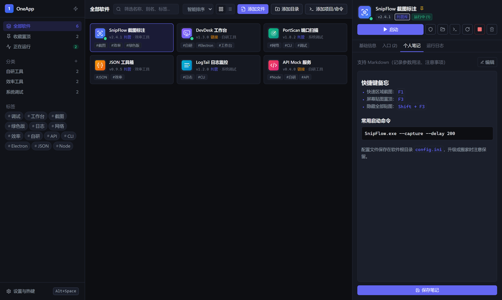

切换到 **「个人笔记」** 标签页，支持标题（`#` / `##` / `###`）、无序列表（`-` / `*`）、行内代码（`` `...` ``）和代码块（```` ``` ````），点右上角 **`编辑 / 预览`** 即可切换所见即所得排版。写好的笔记不仅在这里看，**呼出 `Alt + Space` 启动条时也会直接展示在右侧预览面板中**！

#### 4. 实时构建与运行日志

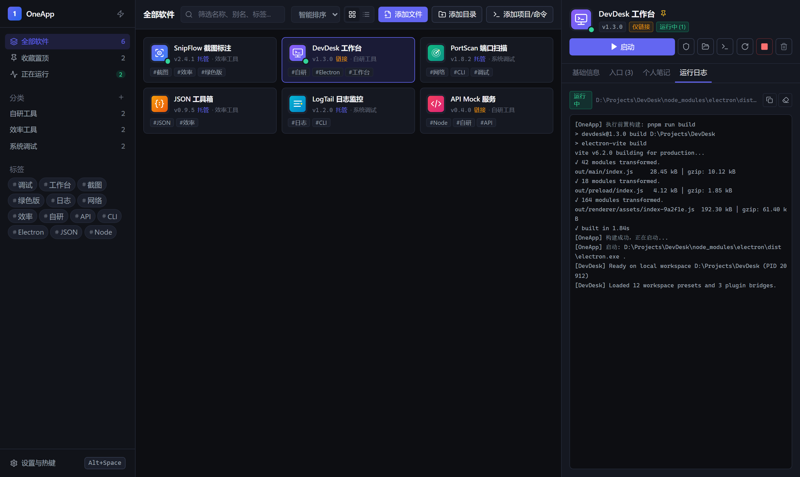

切换到 **「运行日志」** 标签页：
- 只要软件开启了「隐藏黑窗」或触发了「前置构建」，OneApp 就会实时把命令行的 stdout / stderr 逐行捕获进来（每个应用保留最新 500 行），同时清晰显示当前状态徽章（`空闲` / `构建中` / `运行中` / `已退出` / `失败`）。
- 如果构建或启动出错，标签页标题会出现小红点提示，且日志顶部会高亮显示错误摘要；右上角支持**一键复制日志**和**清空日志**。

---

### 4.6 设置与全局热键：按你的习惯定制 OneApp

点击主窗口左下角（或托盘浮窗底部）的 **「设置与热键」**，即可打开设置面板：

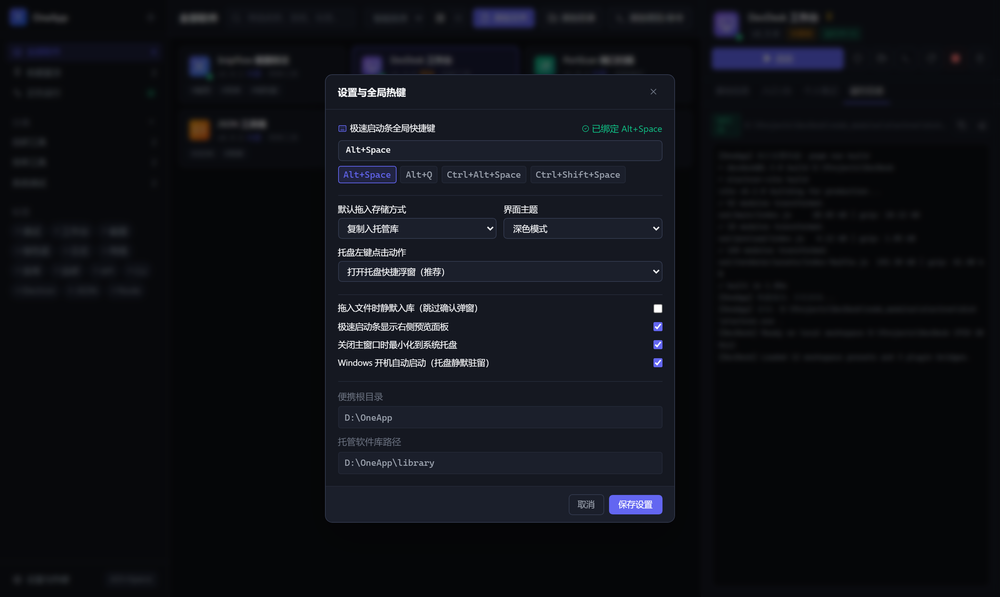

| 设置项 | 默认值 | 小白说明 |
| :--- | :--- | :--- |
| **极速启动条全局快捷键** | `Alt+Space` | 一键显示/隐藏启动条；内置 `Alt+Space`、`Alt+Q`、`Ctrl+Alt+Space`、`Ctrl+Shift+Space` 预设，也可手动输入组合键；右上角会实时显示「已绑定」或「冲突」状态 |
| **默认拖入存储方式** | `复制入托管库` | 控制把软件拖入 OneApp 时默认高亮哪个存储按钮（复制 / 移动 / 仅链接） |
| **界面主题** | `跟随系统` | 可选 `跟随系统`、`深色模式`、`浅色模式`，保存后主窗口、启动条与托盘浮窗会同步切换 |
| **托盘左键点击动作** | `打开托盘快捷浮窗（推荐）` | 可自定义左键单击右下角托盘图标时，弹出托盘快捷浮窗、打开主窗口还是呼出极速启动条 |
| **拖入文件时静默入库** | 关闭 | 开启后，拖入单个程序、文件夹或压缩包时**不再弹出确认窗口**，直接按默认方式自动入库并在右下角轻提示（注意：源码项目或无候选入口目录仍会弹窗让你确认） |
| **极速启动条显示右侧预览面板** | 开启 | 控制 `Alt+Space` 启动条右侧是否展示软件简介、个人笔记和入口列表（按 `Tab` 键随时可展开动作菜单） |
| **关闭主窗口时最小化到系统托盘** | 开启 | 开启后点主窗口右上角 `×` 不会退出程序，而是隐藏到右下角托盘继续待命 |
| **Windows 开机自动启动** | 关闭 | 开启后写入当前用户的 Windows 启动项（带 `--silent` 参数开机静默驻留托盘，不弹窗打扰） |

---

## 5. 绿色便携目录结构与换电脑搬家指南

OneApp 从底层设计就坚持**零污染绿色便携原则**，所有运行时数据与托管软件全部收拢在同一目录下：

```text
OneApp/
├── OneApp.exe                  # 主程序（单文件已内嵌全部前端界面）
├── data/                       # 运行时数据（全本地存储）
│   ├── oneapp.db               # SQLite 主数据库（使用纯 Go 驱动 + WAL 模式）
│   ├── settings.json           # 个人设置（热键、主题、存储偏好等）
│   ├── icons/                  # 自动提取并缓存的高清 PNG 图标
│   ├── cache/                  # 临时缓存目录
│   ├── backups/                # 预留备份目录
│   └── logs/                   # 运行日志目录
└── library/                    # 默认托管软件库根目录
    └── apps/
        ├── snipflow-a1b2c3/    # 每个托管软件独立目录（名称-短ID）
        │   ├── SnipFlow.exe
        │   └── config.ini
        └── portscan-3f7e2a/
            └── portscan.exe
```

### 如何把整个软件库搬到新电脑 / U 盘？
1. 先彻底退出 OneApp（右键右下角托盘图标 → **退出 OneApp**，或点托盘浮窗右下角 **退出**）。
2. 直接把整个 **`OneApp/` 文件夹** 复制或剪切到 U 盘、移动硬盘、OneDrive / 同步盘或新电脑的任意盘符（例如从 `D:\OneApp` 搬到 `E:\Tools\OneApp`）。
3. 在新电脑双击 `OneApp.exe` 打开即可！
   - 所有**「托管库」模式**的软件在数据库里都只存相对路径（例如 `apps/snipflow-a1b2c3`），因此无论换到什么盘符路径，**全部软件、图标、多入口配置、Markdown 笔记与历史统计都会原样恢复，零损坏**！
   - *(注：仅「仅链接原路径」模式指向本地外部目录的项目，若新电脑该路径不存在才需重新指向。)*

---

## 6. 常见问题 FAQ（小白排障）

<details>
<summary><strong>1. 按下 <code>Alt + Space</code> 没有反应，或者提示热键冲突怎么办？</strong></summary>

这通常是因为系统里其他软件（如 PowerToys Run、uTools、Listary 或输入法）占用了 `Alt+Space`。
- **解决办法**：打开主窗口左下角「设置与热键」，点击预设按钮（如 `Alt+Q`、`Ctrl+Alt+Space`、`Ctrl+Shift+Space`）或自行输入不冲突的组合键后点「保存设置」即可立即生效。

</details>

<details>
<summary><strong>2. 为什么我把文件拖到 OneApp 窗口里没有反应（出现禁止符号）？</strong></summary>

这是 Windows 系统的 **UIPI（用户界面特权隔离）安全机制**：高权限（管理员身份）运行的窗口无法接收低权限资源管理器拖入的文件。
- **解决办法**：请始终以**普通用户权限**直接双击运行 `OneApp.exe`（不要在 exe 属性里勾选“以管理员身份运行此程序”）。如果你需要用管理员权限启动某个工具，只需在 OneApp 里为该工具勾选「默认管理员」，或启动时按 `Ctrl + Enter` / 点击盾牌图标按需提权即可。

</details>

<details>
<summary><strong>3. 导入 Electron 项目后启动报错，提示找不到 <code>electron.exe</code> 怎么办？</strong></summary>

这说明该项目目录下还没有安装依赖（`node_modules/electron/dist/electron.exe` 不存在）。
- **解决办法**：在该项目目录打开终端执行一次 `pnpm install`（或 `npm install`），安装完成后即可直接从 OneApp 秒开。

</details>

<details>
<summary><strong>4. 我添加的命令行脚本或项目启动后没有反应、或者一闪而过怎么排查？</strong></summary>

- **解决办法**：选中该软件，切换到右侧详情抽屉的 **「入口」** 标签，确认勾选了 **「隐藏黑窗」** 并保存，然后重新点击启动，并切换到 **「运行日志」** 标签页——这里会完整打印出真实执行的命令、环境变量及程序报错输出，排查问题一目了然。

</details>

<details>
<summary><strong>5. 点主窗口右上角的 × 关不掉程序怎么办？</strong></summary>

默认开启了「关闭主窗口时最小化到系统托盘」，方便你随时按 `Alt + Space` 唤醒。
- **彻底退出方式**：右键点击桌面右下角任务栏托盘里的 OneApp 图标 → 选择 **「退出 OneApp」**；或者单击托盘图标打开浮窗，点击右下角 **「退出」** 按钮。如果希望以后点 `×` 直接退出，可以在「设置与热键」中取消勾选“关闭主窗口时最小化到系统托盘”。

</details>

---

## 7. 开发者：从源码编译与运行

### 环境要求

- **操作系统**：Windows 10 / Windows 11（系统已内置 Microsoft Edge WebView2 Runtime）
- **Go**：1.26+（纯 Go 实现，**零 CGO 依赖**，无需安装 MinGW / GCC）
- **Node.js & pnpm**：Node.js 20+（已验证 v22.19.0）、pnpm（已验证 10.x）
- **Wails v3 CLI**：`v3.1.0`

### 一键编译构建步骤（PowerShell）

```powershell
# 1. 克隆仓库
git clone https://github.com/backbay2-yzg/OneApp.git
cd OneApp

# 2. 安装 Wails v3 CLI（用于生成前端 TypeScript 接口绑定）
go install github.com/wailsapp/wails/v3/cmd/wails3@latest

# 3. 生成 Wails v3 TypeScript 绑定（注意必须带 -ts -i 参数）
wails3 generate bindings -ts -i

# 4. 安装前端依赖并打包生产静态资源
cd frontend
pnpm install
pnpm build
cd ..

# 5. 编译为无控制台黑框的纯 Go Windows 单文件
go build -ldflags "-H windowsgui -s -w" -o build/bin/OneApp.exe .
```

### 运行单元测试

```powershell
go test ./...
```

### 源码目录结构

```text
OneApp/
├── main.go                     # 程序入口、便携目录解析、Wails v3 装配与单实例控制
├── assets/icon.png             # 应用图标与系统托盘图标
├── internal/
│   ├── app/                    # Wails v3 窗口控制（主窗口/启动条/托盘浮窗）、系统托盘、全局热键、文件拖放
│   ├── config/                 # 便携目录路径解析 (Paths) 与 settings.json 原子读写
│   ├── domain/                 # 核心领域模型（App / AppEntry / IngestAnalysis / SearchHit 等）
│   ├── archive/                # 纯 Go .zip / .7z 解压与单根目录剥离
│   ├── platform/               # OS 抽象接口及 Windows Win32/COM 实现（PE 信息、图标提取、.lnk、UAC、自启）
│   ├── service/                # 核心业务服务：入库分析、Electron/Node 项目识别、拼音与 Frecency 检索、启动与日志
│   └── storage/                # 纯 Go SQLite（modernc.org/sqlite）连接、Schema 自动迁移与 Repository
├── frontend/
│   ├── src/main/               # 管理主窗口、详情抽屉、入库确认弹窗、项目/命令弹窗、设置弹窗
│   ├── src/launcher/           # 极速启动条 (#/launcher)
│   ├── src/tray/               # 托盘快捷浮窗 (#/tray)
│   └── src/shared/             # Zustand 状态同步、图标组件、主题切换
└── docs/
    ├── index.html              # GitHub Pages 在线图文文档站点
    ├── screenshots/            # 文档高清界面截图
    ├── PRD.md                  # 产品需求文档
    └── ARCHITECTURE.md         # 系统架构与工程路线图
```

---

## 8. 设计文档与后续规划

- 📖 **在线图文使用手册（GitHub Pages）**：[https://backbay2-yzg.github.io/OneApp/](https://backbay2-yzg.github.io/OneApp/)
- 📋 **产品需求文档**：[docs/PRD.md](docs/PRD.md)
- 🏗️ **系统架构文档**：[docs/ARCHITECTURE.md](docs/ARCHITECTURE.md)

> **后续规划（Roadmap，详见 PRD 与架构文档）：**
> 正在规划与演进中的能力包括：GitHub Release 链接直拉与智能资产匹配（含私有库 PAT 与代理）、配置零丢失自动更新（Install Manifest Diff + 历史版本备份回滚）、批量文件夹扫描导入向导、单软件独立全局热键以及轻量换机清单 `oneapp-manifest.json` 导出与重拉。
