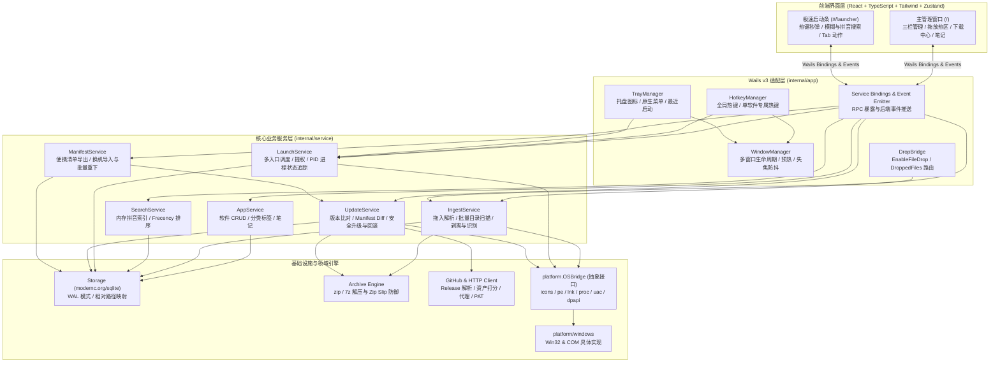
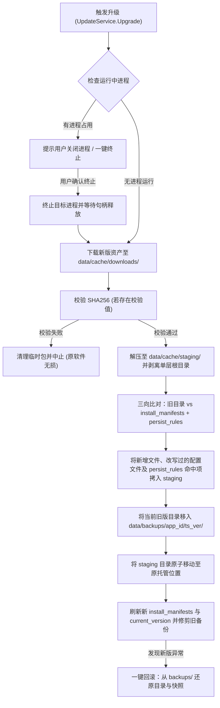

# OneApp 系统架构与工程路线图（ARCHITECTURE）

> **文档状态**：待审阅确认（Draft v1.0）
> **关联文档**：[PRD.md](./PRD.md)
> **目标平台**：Windows 10 / Windows 11 优先（通过 OS 抽象接口保留跨平台扩展能力）

---

## 1. 技术栈与选型依据

### 1.1 总体选型矩阵

| 分层 | 选型方案 | 选型依据与关键特性 |
| :--- | :--- | :--- |
| **桌面应用宿主** | **Wails v3** (`github.com/wailsapp/wails/v3`) | 复用系统内置 WebView2，产物体积小、常驻内存低；原生支持多窗口（`app.Window.NewWithOptions`）、系统托盘（`app.SystemTray.New`）、系统级文件拖放（`EnableFileDrop` + `WindowFilesDropped`）和全局快捷键（`app.GlobalShortcut.Register`）。 |
| **后端语言与约束** | **Go 1.24**（**纯 Go / 零 CGO**） | 本地工具链已就绪（已验证 `go1.24.12`）；强制零 CGO 保证不依赖 MinGW/GCC，编译速度快、二进制干净、交叉与便携构建稳定。 |
| **嵌入式数据库** | **`modernc.org/sqlite`**（Pure Go） | 无需 CGO 的完整 SQLite 实现；配合 WAL 日志模式与 `PRAGMA foreign_keys = ON`，兼顾高可靠事务与便携单文件存储。 |
| **压缩包处理** | 标准库 `archive/zip` + **`github.com/bodgit/sevenzip`** | 全纯 Go 解压 `.zip` 与 `.7z`，无需随程序捆绑外部 `7z.exe` 或 `unrar.dll`。 |
| **拼音与文本检索** | **`github.com/mozillazg/go-pinyin`** + 内存索引 | 支持入库时预生成中文全拼与拼音首字母索引，结合内存子串/模糊打分实现毫秒级启动条响应。 |
| **Windows 底层能力** | **`golang.org/x/sys/windows`** + Win32/COM 调用 | 直接调用 Win32/Shell API 完成高清图标提取、PE 版本解析、`.lnk` 解析、UAC 提权、隐藏黑窗、进程控制与 DPAPI 加密。 |
| **前端界面层** | **React + TypeScript + Vite + Tailwind CSS + Zustand + Lucide Icons** | 本地工具链已就绪（已验证 `node v22.19.0`、`pnpm 10.26.1`）；单份前端产物通过路由区分双窗口，开发效率与键盘无障碍体验最佳。 |

### 1.2 双窗口共用前端产物设计

Wails v3 后端将 Vite 构建后的静态资源通过 `//go:embed` 内嵌进单个 `OneApp.exe`：
- **主管理窗口（`MainWindow`）**：加载根路由 `/`，支持正常标题栏/自定义极简标题栏、三栏管理界面与全窗口拖放热区（`data-file-drop-target`）。
- **极速启动条（`LauncherWindow`）**：加载哈希路由 `#/launcher`，无边框、置顶、透明/阴影圆角样式，程序启动即创建并默认 `Hide()` 预热，避免按下全局热键时产生 WebView 初始化延迟。
- **跨窗口状态同步**：当主窗口完成软件增删改、下载或升级时，后端服务通过 Wails 事件总线广播变更事件（如 `apps:changed`、`process:status`、`download:progress`），主窗口与启动条共享后端最新内存索引与状态。

---

## 2. 系统分层架构



---

## 3. 目录布局设计

### 3.1 运行时绿色便携目录布局

OneApp 默认采用**绿色便携目录结构**，将可执行文件、元数据与默认托管库同目录收拢；用户整包复制到 U 盘或同步文件夹即可跨机使用：

```text
OneApp/
├── OneApp.exe                        # 主程序（单文件内嵌前端资源）
├── data/                             # 运行时数据与状态（全本地）
│   ├── oneapp.db                     # SQLite 主数据库（含 WAL 文件）
│   ├── settings.json                 # 用户偏好、热键、代理、主题、DPAPI 加密凭据
│   ├── icons/                        # 提取并缓存的 PNG 图标（<app_id>.png）
│   ├── cache/
│   │   ├── downloads/                # 下载中临时包与校验缓存
│   │   └── staging/                  # 升级与解压暂存沙箱目录
│   ├── backups/
│   │   └── <app_id>/                 # 历史版本备份快照（供一键回滚）
│   │       └── 20261124_150000_v1.2.0/
│   └── logs/                         # 轮转运行日志（排障与升级审计）
└── library/                          # 默认托管软件库根目录（路径可自定义）
    └── apps/
        ├── my-port-scan-8f3a1c/      # 每个托管软件独立子目录（slug + shortid）
        │   ├── portscan.exe
        │   └── config.json
        └── snipaste-2c91b0/
            ├── Snipaste.exe
            └── config.ini
```

### 3.2 工程源代码目录结构

```text
d:\OneApp\
├── docs/                             # 产品与架构设计文档
│   ├── PRD.md
│   └── ARCHITECTURE.md
├── cmd/
│   └── oneapp/
│       └── main.go                   # 应用入口、便携根目录解析、Wails v3 装配
├── internal/
│   ├── domain/                       # 核心领域实体、错误码与 DTO 定义
│   ├── app/                          # Wails v3 适配层（多窗口、托盘、全局热键、拖放事件）
│   ├── storage/                      # SQLite 连接管理、Schema 迁移、Repository 实现
│   ├── service/                      # 核心业务逻辑（Ingest / Search / Launch / Update / Manifest）
│   ├── archive/                      # .zip / .7z 安全解压、单根目录剥离、文件清单哈希计算
│   ├── github/                       # GitHub Release API、URL 解析、Windows 资产智能打分、流式下载
│   └── platform/                     # 跨平台 OS 抽象接口定义
│       ├── bridge.go                 # OSBridge 接口契约（图标、PE、进程、提权、DPAPI、自启）
│       ├── windows/                  # Windows 10/11 具体实现（//go:build windows）
│       └── stub/                     # 非 Windows 平台占位实现（保留跨平台编译契约）
├── frontend/
│   ├── package.json
│   ├── vite.config.ts
│   ├── tailwind.config.ts
│   └── src/
│       ├── main/                     # 主管理窗口页面与组件
│       ├── launcher/                 # 极速启动条页面、键盘导航与 Tab 动作面板
│       └── shared/                   # 共享类型定义、Wails 调用封装、样式 Token
├── go.mod
└── Taskfile.yml / Makefile           # 开发、测试与零 CGO 构建脚本
```

---

## 4. SQLite 核心数据模型与清单契约

### 4.1 路径解析与便携规范

- **托管模式（`storage_mode = 'managed'`）**：`root_path` 存相对于 `library/` 根目录的路径（如 `apps/my-port-scan-8f3a1c`）；各入口 `entry_path` 存相对于 `root_path` 的路径（如 `bin/portscan.exe`）。整包搬迁至任意电脑盘符时，运行时自动按 `LibraryRoot + root_path + entry_path` 拼接，**零路径失效**。
- **仅链接模式（`storage_mode = 'linked'`）**：`root_path` 存用户指定的本地目录或环境变量路径（如 `D:\Dev\MyTool\dist`），入口同样以相对 `root_path`（或直接文件路径）解析，升级和删除操作**严禁误删用户外部原目录**。
- **待补齐状态（`status = 'pending_files'`）**：换机导入轻量清单后，纯本地工具处于待补齐占位态，待用户拖入文件后平滑切换为 `ready`。

### 4.2 SQLite DDL 草案

```sql
PRAGMA foreign_keys = ON;
PRAGMA journal_mode = WAL;

-- 1. 软件主表
CREATE TABLE IF NOT EXISTS apps (
    id                TEXT PRIMARY KEY,              -- UUID / ULID
    slug              TEXT NOT NULL,                 -- 目录安全名
    name              TEXT NOT NULL,                 -- 显示名称
    aliases_json      TEXT NOT NULL DEFAULT '[]',    -- JSON 数组: ["jt", "snip"]
    description       TEXT NOT NULL DEFAULT '',      -- 简短描述
    notes_md          TEXT NOT NULL DEFAULT '',      -- 个人 Markdown 使用笔记
    icon_rel_path     TEXT NOT NULL DEFAULT '',      -- 相对 data/icons/ 的图标路径
    category_id       TEXT REFERENCES categories(id) ON DELETE SET NULL,
    is_pinned         INTEGER NOT NULL DEFAULT 0,    -- 0/1 收藏置顶
    hotkey            TEXT NOT NULL DEFAULT '',      -- 单软件独立全局快捷键

    storage_mode      TEXT NOT NULL CHECK (storage_mode IN ('managed', 'linked')),
    status            TEXT NOT NULL DEFAULT 'ready' CHECK (status IN ('ready', 'pending_files', 'missing')),
    root_path         TEXT NOT NULL DEFAULT '',      -- managed 为相对 library/ 路径；linked 为外部路径

    -- 线上来源与更新元数据
    source_type       TEXT NOT NULL DEFAULT 'local' CHECK (source_type IN ('local', 'github', 'direct_url')),
    source_url        TEXT NOT NULL DEFAULT '',      -- 仓库/Release/直链 URL
    asset_pattern     TEXT NOT NULL DEFAULT '',      -- 选定资产命名模式，便于自动匹配后续版本
    include_prerelease INTEGER NOT NULL DEFAULT 0,
    current_version   TEXT NOT NULL DEFAULT '',      -- 当前已安装版本号/Tag
    latest_version    TEXT NOT NULL DEFAULT '',      -- 远端检测到最新版本
    remote_etag       TEXT NOT NULL DEFAULT '',      -- 直链 ETag/Last-Modified 指纹
    persist_rules_json TEXT NOT NULL DEFAULT '[]',   -- JSON 数组: ["config/**", "*.ini"]

    -- 排序与统计
    launch_count      INTEGER NOT NULL DEFAULT 0,
    last_launched_at  INTEGER NOT NULL DEFAULT 0,    -- Unix 毫秒时间戳
    last_checked_at   INTEGER NOT NULL DEFAULT 0,
    created_at        INTEGER NOT NULL,
    updated_at        INTEGER NOT NULL
);

CREATE INDEX IF NOT EXISTS idx_apps_category ON apps(category_id);
CREATE INDEX IF NOT EXISTS idx_apps_status ON apps(status);
CREATE INDEX IF NOT EXISTS idx_apps_frecency ON apps(is_pinned DESC, last_launched_at DESC, launch_count DESC);

-- 2. 软件多入口表（主入口 + 辅助入口）
CREATE TABLE IF NOT EXISTS app_entries (
    id                TEXT PRIMARY KEY,
    app_id            TEXT NOT NULL REFERENCES apps(id) ON DELETE CASCADE,
    name              TEXT NOT NULL,                 -- 如 "主程序"、"CLI 服务端"
    entry_type        TEXT NOT NULL CHECK (entry_type IN ('exe', 'bat', 'cmd', 'ps1', 'lnk')),
    rel_path          TEXT NOT NULL,                 -- 相对 app root_path 的入口路径
    args_template     TEXT NOT NULL DEFAULT '',      -- 启动参数模板，支持 {{APP_DIR}}
    working_dir       TEXT NOT NULL DEFAULT '',      -- 默认空表示入口所在目录
    env_vars_json     TEXT NOT NULL DEFAULT '{}',    -- JSON 对象: {"PORT": "8080"}
    run_as_admin      INTEGER NOT NULL DEFAULT 0,    -- 默认是否 UAC 提权
    hide_console      INTEGER NOT NULL DEFAULT 0,    -- 是否隐藏控制台黑窗
    prompt_args       INTEGER NOT NULL DEFAULT 0,    -- 启动前是否弹窗询问附加参数
    is_primary        INTEGER NOT NULL DEFAULT 0,    -- 是否默认主入口
    sort_order        INTEGER NOT NULL DEFAULT 0
);

CREATE INDEX IF NOT EXISTS idx_entries_app ON app_entries(app_id, is_primary DESC, sort_order ASC);

-- 3. 分类与标签
CREATE TABLE IF NOT EXISTS categories (
    id                TEXT PRIMARY KEY,
    name              TEXT NOT NULL UNIQUE,
    sort_order        INTEGER NOT NULL DEFAULT 0
);

CREATE TABLE IF NOT EXISTS tags (
    id                TEXT PRIMARY KEY,
    name              TEXT NOT NULL UNIQUE
);

CREATE TABLE IF NOT EXISTS app_tags (
    app_id            TEXT NOT NULL REFERENCES apps(id) ON DELETE CASCADE,
    tag_id            TEXT NOT NULL REFERENCES tags(id) ON DELETE CASCADE,
    PRIMARY KEY (app_id, tag_id)
);

-- 4. 安装原始文件清单（用于升级时 Install Manifest Diff 保护本地配置）
CREATE TABLE IF NOT EXISTS install_manifests (
    app_id            TEXT NOT NULL REFERENCES apps(id) ON DELETE CASCADE,
    rel_path          TEXT NOT NULL,                 -- 相对 app root_path 的正斜杠路径
    sha256            TEXT NOT NULL,
    file_size         INTEGER NOT NULL,
    PRIMARY KEY (app_id, rel_path)
);

-- 5. 升级历史备份记录（支持一键回滚）
CREATE TABLE IF NOT EXISTS update_backups (
    id                TEXT PRIMARY KEY,
    app_id            TEXT NOT NULL REFERENCES apps(id) ON DELETE CASCADE,
    version           TEXT NOT NULL,
    backup_rel_path   TEXT NOT NULL,                 -- 相对 data/backups/ 的目录路径
    manifest_snapshot TEXT NOT NULL DEFAULT '[]',    -- 当时 install_manifests JSON 快照
    created_at        INTEGER NOT NULL
);

CREATE INDEX IF NOT EXISTS idx_backups_app ON update_backups(app_id, created_at DESC);

-- 6. 启动历史审计（用于精细统计与最近启动列表）
CREATE TABLE IF NOT EXISTS launch_history (
    id                TEXT PRIMARY KEY,
    app_id            TEXT NOT NULL REFERENCES apps(id) ON DELETE CASCADE,
    entry_id          TEXT NOT NULL,
    launched_at       INTEGER NOT NULL,
    elevated          INTEGER NOT NULL DEFAULT 0
);

CREATE INDEX IF NOT EXISTS idx_launch_history_time ON launch_history(launched_at DESC);
```

### 4.3 换机轻量导出清单（`oneapp-manifest.json`）

```json
{
  "schema_version": 1,
  "exported_at": "2026-11-24T15:10:00+08:00",
  "categories": ["自研工具", "网络调试", "效率工具"],
  "apps": [
    {
      "name": "PortScanner",
      "aliases": ["ps", "duankou"],
      "category": "自研工具",
      "tags": ["网络", "CLI"],
      "description": "自研极速端口检测小工具",
      "notes_md": "常用参数: -p 8000-9000 --fast",
      "storage_mode": "managed",
      "source_type": "github",
      "source_url": "https://github.com/myuser/port-scanner",
      "asset_pattern": "port-scanner-*-win-amd64.zip",
      "include_prerelease": false,
      "current_version": "v1.4.2",
      "persist_rules": ["config.json", "logs/**"],
      "hotkey": "Ctrl+Alt+P",
      "entries": [
        {
          "name": "主程序",
          "entry_type": "exe",
          "rel_path": "port-scanner.exe",
          "args_template": "--config {{APP_DIR}}\\config.json",
          "working_dir": "",
          "env_vars": {},
          "run_as_admin": false,
          "hide_console": false,
          "is_primary": true
        }
      ]
    }
  ]
}
```
*(导出严格执行脱敏：不包含任何 GitHub PAT、本地代理密码或本机临时路径。)*

---

## 5. 关键子系统设计细节

### 5.1 安全升级与配置保留状态机

升级采用 **Staging 合并 + 备份切换** 模型，确保中途断电、文件占用或新版异常时绝不丢配置：



**三向保留判定伪代码逻辑**：
```text
对于当前运行目录中的每一个文件 F (相对路径 P):
  1. 若 P 命中用户 persist_rules (glob) -> 保留 F (覆盖进 staging 同路径)
  2. 否则查询上次入库指纹 old_hash = install_manifests[P]:
     - 若 old_hash 不存在 (运行后新增的数据/配置/日志) -> 保留 F
     - 若 old_hash 存在，但 SHA256(F) != old_hash (已被修改过的配置) -> 保留 F
     - 若 SHA256(F) == old_hash (原版程序未改动文件) -> 不保留，由新版替换
```

### 5.2 内存拼音与模糊搜索索引及 Frecency 模型

为保障启动条按键即出结果（目标后端检索耗时 `< 5ms`），`SearchService` 在内存维护一份轻量的 `[]SearchEntry`：
- **入库/更新时预计算字段**：
  - `LowerName`（小写名称）
  - `PinyinFull`（连续全拼，如 `jietugongju`）
  - `PinyinInitials`（首字母串，如 `jtgj`）
  - `LowerAliases`、`LowerTags`、`CategoryName`
- **Query 语法解析**：提取 `#tag`、`@category`、`:running`、`:update` 修饰词，剩余词项作为关键词。
- **综合排序公式**：
  $$Score = W_{match} \times MatchQuality(q, entry) + W_{freq} \times \ln(1 + launch\_count) + W_{recency} \times Decay(now - last\_launched) + W_{pin}$$
  其中：
  - `MatchQuality` 优先级：别名精确匹配 > 名称前缀匹配 > 拼音首字母前缀匹配 > 全拼前缀匹配 > 子串匹配 > 跳字模糊匹配（Fuzzy）；
  - `Decay` 采用分段半衰期衰减（24 小时内使用加高权重、7 天内次之、30 天外平缓衰减）。

### 5.3 OS 抽象接口（`platform.OSBridge`）与 Windows 实现

为了“Windows 为主，同时保留跨平台能力”，所有平台强耦合逻辑均收口在 `internal/platform/bridge.go` 接口之后，业务层不直接引入 `syscall` 或 `windows` 包：

| 抽象能力 | 接口职责 | Windows 10/11 具体实现策略 |
| :--- | :--- | :--- |
| **图标提取** | `ExtractIcon(path, outPNG)` | 优先调用 Shell `SHGetImageList(SHIL_JUMBO)` / `ExtractIconExW` 获取最高清晰度图标（256x256 或 48x48）并编码保存为本地 PNG；无图标的脚本/CLI 赋予内置统一分类图标。 |
| **版本信息** | `ReadExecutableMeta(path)` | 解析 Win32 PE 资源 `GetFileVersionInfoW`（`FileVersion`、`ProductName`、`FileDescription`）。 |
| **快捷方式解析** | `ResolveShortcut(lnkPath)` | 通过 Windows COM `IShellLinkW` / `IPersistFile` 解析目标程序路径、原参数、起始目录和图标位置。 |
| **程序启动** | `Launch(spec LaunchSpec)` | 普通启动走 `os/exec`（通过 `SysProcAttr{CreationFlags: CREATE_NO_WINDOW}` 控制隐藏黑窗）；当 `RunAsAdmin=true` 时调用 `ShellExecuteExW` 传入 `"runas"` 动词单独提权子进程。 |
| **进程探测与终止** | `IsProcessAlive(pid, exe)` / `TerminateProcess(pid)` | 结合创建进程 PID 校验进程可执行文件路径（防止 PID 复用误杀），使用 `TerminateProcess` / 优雅关闭信号结束进程。 |
| **凭据安全** | `ProtectSecret` / `UnprotectSecret` | 调用 Windows `CryptProtectData` / `CryptUnprotectData`（DPAPI 当前用户密钥域）加密 GitHub PAT 后再存入本机 `settings.json`。 |
| **桌面集成** | `RevealInFileManager` / `OpenTerminal` / `SetAutoStart` | `explorer.exe /select,<path>` 高亮定位文件；`wt.exe -d <dir>` 或回退 `powershell.exe` 打开终端；写 `HKCU\Software\Microsoft\Windows\CurrentVersion\Run` 管理开机自启。 |

---

## 6. 关键工程防坑清单（Pitfalls & Mitigations）

| 风险项 | 潜在踩坑表现 | 架构应对措施 |
| :--- | :--- | :--- |
| **1. Windows UIPI 拖放隔离** | 若 OneApp 自身以管理员权限启动，普通权限的 Windows 资源管理器**无法将任何文件拖入 OneApp 窗口**（系统会静默拒绝 WM_DROPFILES）。 | **铁律**：OneApp 主程序 manifest 严格保持 `asInvoker`（普通权限运行），**绝不全局提权**；仅在启动需要提权的目标子工具时按需走 `ShellExecuteExW("runas")`。 |
| **2. 启动条唤醒延迟与失焦闪烁** | 每次按热键才新建 WebView 窗口会有 300ms+ 白屏闪烁；失焦立即关闭可能导致点击内部弹出菜单或切换瞬间闪退。 | 进程启动时后台创建并 `Hide()` 预热启动条窗口；失焦隐藏加 `80ms~120ms` 防抖，且当弹出临时参数输入框时不触发失焦关闭。 |
| **3. 全局快捷键冲突** | 默认 `Alt + Space` 极易与 PowerToys Run、uTools 或 Windows 系统窗口菜单冲突导致静默注册失败。 | 捕获 `GlobalShortcut.Register` 返回的错误，在界面顶部/托盘提示冲突，引导用户一键改绑（如 `Alt + Q`、`Ctrl + Space` 或 `Ctrl + Alt + Space`）。 |
| **4. 压缩包安全与套娃目录** | 恶意或非规范压缩包可能含 `../../` 路径穿越（Zip Slip），或顶层多包一层版本文件夹导致后续相对路径不稳定。 | 解压前强制校验目标路径必须位于 `staging` 根目录前缀内；解压后若顶层仅存在唯一目录则自动上提剥离后再计算 `install_manifests`。 |
| **5. 升级过程中的文件锁占用** | Windows 下 `.exe`/`.dll` 运行时不可覆盖或移动，直接替换会报错留下半残目录。 | 升级前主动检测目标目录/PID 是否活跃，提示并协助关闭进程；随后先在 `staging` 完整组装，再整目录移入 `backups` 与原子替换，降低中途损坏概率。 |
| **6. 凭据泄露与便携冲突** | 换机分享/导出 `oneapp-manifest.json` 时意外带上 GitHub Token。 | 导出逻辑与 `settings.json` 物理隔离，manifest 结构根本不设凭据字段；本地 Token 经 DPAPI 加密保存（注：跨电脑拷贝便携盘后 Token 需在新机器重新填一次，属于预期安全行为）。 |
| **7. Wails v3 API 演进风险** | Wails v3 仍处于快速演进阶段，窗口/事件/托盘局部 API 签名可能微调。 | 所有 Wails v3 类型与 API 严格隔离在 `internal/app/` 适配层，核心 `internal/service/` 仅依赖 Go 标准类型与自定回调接口，避免框架改动波及核心业务。 |

---

## 7. 分阶段开发路线图（Roadmap）

### Phase 1：核心管理与极速启动 MVP（可日常替代手翻文件夹）
- **目标**：跑通「本地软件纳管 + 极速搜索打开 + 拖入入库 + 托盘常驻」完整最小可用闭环。
- **交付范围**：
  1. 初始化 Wails v3 + Go 1.24 + React/TS/Tailwind 项目骨架与零 CGO SQLite 存储层。
  2. 实现 `platform/windows` 基础能力（图标提取、PE 版本解析、`.lnk` 解析、普通启动/管理员提权/隐藏控制台、打开目录与终端）。
  3. 实现 `IngestService`：支持拖入单 `.exe`/整包目录/`.zip`/`.7z`/脚本；自动剥离单层嵌套目录与启发式主入口识别；拖入确认卡支持「复制/移动入库/仅链接原路径」。
  4. 实现主管理窗口（Raycast/Linear 风格三栏布局、列表/卡片切换、基础信息与单入口编辑）与系统托盘。
  5. 实现常驻预热极速启动条（全局热键唤出、全拼/首字母/模糊/别名/#标签/@分类搜索、Frecency 排序、`Tab` 二级动作面板与运行状态绿点）。
- **阶段验收标准**：从资源管理器拖入自研 `.exe` 或 `.zip` 即可 3 秒内入库，按快捷键呼出启动条搜拼音首字母回车秒开软件，整体打包后拷入另一路径依旧正常运行。

### Phase 2：线上下载、安全更新闭环与自研工具深度增强
- **目标**：打通 GitHub/直链获取与“配置零丢失”升级回滚，补全自研工具的多入口与文档能力。
- **交付范围**：
  1. 实现 `github` 客户端：支持仓库/Release/直链解析、Windows 便携资产智能打分与候选交互、流式下载进度条、SHA256 校验。
  2. 支持设置 GitHub PAT（Windows DPAPI 加密存储，适配私有库与提额）、HTTP/SOCKS5 代理及加速镜像前缀。
  3. 实现 `UpdateService`：一键检查更新、Staging 合并、**Install Manifest Diff + `persist_rules` 双保险配置保留**、历史版本备份与一键回滚。
  4. 补全自研工具深度管理：软件多入口配置、自定义环境变量与参数模板（`{{APP_DIR}}`）、启动前动态询问参数、内置 Markdown 个人使用笔记编辑与启动条右侧预览。
- **阶段验收标准**：粘贴一个 GitHub 仓库链接自动选出 Windows 便携包下载入库；模拟修改软件目录下 `config.json` 并新增 `data/test.txt` 后执行版本升级，验证新 `.exe` 上线且原配置与新增数据 100% 完整保留，回滚按钮可正确退回旧版。

### Phase 3：批量迁移、换机清单与工程打磨
- **目标**：降低存量工具迁移门槛，完善换机体验、独立热键与发布品质。
- **交付范围**：
  1. 实现「已有文件夹批量扫描导入向导」（一键识别整个工具目录并批量选择复制/移动/链接入库）。
  2. 实现 `oneapp-manifest.json` 导出与换机导入流程（线上源批量重拉恢复 + 本地自研待补齐占位与拖入重绑）。
  3. 支持单软件独立全局快捷键、深浅色主题切换、热键冲突引导、开机自启动开关。
  4. 补齐核心单元测试（资产打分、搜索与拼音匹配、Install Manifest Diff、Zip Slip 防御、便携相对路径解析）与打包发布脚本。
- **阶段验收标准**：导出的 `oneapp-manifest.json` 在全新空环境中导入，可自动批量下载恢复 GitHub 工具并完整保留笔记与参数配置；本地工具通过拖入待补齐占位完成绑定；核心引擎单测全部通过。
